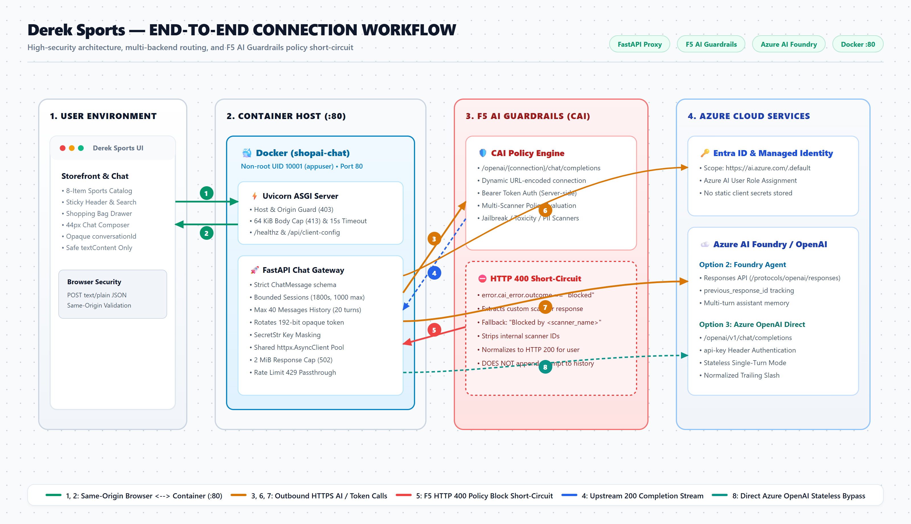

# Derek Sports — ShopAI Athletic Gear

[](https://fastapi.tiangolo.com)
[](https://www.python.org/)
[](https://www.docker.com/)
[]()

Production-structured athletic gear storefront and multi-backend AI chat web application powered by **F5 AI Guardrails (CalypsoAI)**, **Azure AI Foundry Agents**, and **Azure OpenAI Direct Completions**.



---

## Quick Start — Run Locally with Docker

The fastest way to run **Derek Sports — ShopAI** is using Docker. The container builds on `python:3.12-slim`, drops root privileges (`USER appuser`, UID 10001), and binds directly to privileged port `80` using Linux capabilities (`cap_net_bind_service=+ep`).

### 1. Configure Environment
```bash
cp .env.example .env
```
Open `.env` in your text editor. Option 1 (**F5 AI Guardrails**) is active by default. Enter your F5 API token and connection name:
```dotenv
F5_GUARDRAILS_API_TOKEN=your-real-cai-api-token
F5_GUARDRAILS_CONNECTION_NAME=your-cai-project-name
```

### 2. Build Container Image
```bash
docker build -t shopai-chat .
```

### 3. Run Container
#### PowerShell (Windows)
```powershell
# Background detached mode (-d) — container stays running
docker rm -f shopai-chat 2>$null; docker run -d --rm -p 80:80 --env-file .env --name shopai-chat shopai-chat
docker logs -f --tail 30 shopai-chat

# Foreground mode (logs stream in terminal; Ctrl+C stops container)
docker rm -f shopai-chat 2>$null; docker run --rm -p 80:80 --env-file .env --name shopai-chat shopai-chat
```

#### Bash / macOS / Linux
```bash
# Background detached mode (-d) — container stays running
docker rm -f shopai-chat 2>/dev/null; docker run -d --rm -p 80:80 --env-file .env --name shopai-chat shopai-chat
docker logs -f --tail 30 shopai-chat

# Foreground mode (logs stream in terminal; Ctrl+C stops container)
docker rm -f shopai-chat 2>/dev/null; docker run --rm -p 80:80 --env-file .env --name shopai-chat shopai-chat
```

Open [http://localhost](http://localhost) in your browser to explore the storefront, browse the 8-item sports catalog, and chat with ShopAI!

---

## Environment Configuration & Variable Reference

All configuration is loaded via Pydantic Settings with `SecretStr` masking. Process environment variables always take precedence over values inside `.env`.

### Shared Application Settings

| Variable | Default / Example | Required | Description |
| :--- | :--- | :--- | :--- |
| `PUBLIC_ORIGIN` | `http://localhost` | Yes | Exact public origin used to enforce same-origin Host and Origin verification. Must use `https://` for public domains; `http://localhost` and `http://127.0.0.1` (with optional port) permitted for local dev only. |
| `CHAT_PATH` | `/api/proxy` | Yes | Path where the browser posts chat messages. Must begin with a single `/`, cannot be `/api/client-config`, and cannot be protocol-relative (`//`). |
| `CHAT_TIMEOUT_SECONDS` | `60` | No | Timeout in seconds for upstream provider requests (capped at 120s). |
| `PORT` | `80` | No | TCP listener port for Uvicorn inside the container. |
| `SSL_VERIFY` | `false` (local dev) | Yes | TLS verification toggle on outbound HTTP calls. Allowed to be `false` **ONLY** when `PUBLIC_ORIGIN` is `localhost` or `127.0.0.1`. Must be set to `true` on public HTTPS domains. |
| `CHAT_BACKEND` | `f5` | Yes | Selects active backend: `f5`, `foundry_agent`, or `foundry_openai`. No silent fallback. |

### Option 1: F5 AI Guardrails (`CHAT_BACKEND=f5` — Default)

| Variable | Default / Example | Required | Description |
| :--- | :--- | :--- | :--- |
| `F5_GUARDRAILS_API_TOKEN` | `your-API-token...` | Yes | F5 AI Guardrails / CalypsoAI API secret bearer token. |
| `F5_GUARDRAILS_BASE_URL` | `https://us2.calypsoai.app` | Yes | SaaS origin URL (`https://us2.calypsoai.app` or `https://us1.calypsoai.app`). No path components. |
| `F5_GUARDRAILS_CONNECTION_NAME` | `your-cai-project` | Yes | Exact connection / project name configured in the F5 console. Dynamically URL-encoded on requests. |
| `F5_GUARDRAILS_MODEL` | `gpt-4.1` | Yes | Model deployment expected by that F5 CAI connection. |

### Option 2: Saved Azure AI Foundry Agent (`CHAT_BACKEND=foundry_agent`)

| Variable | Default / Example | Required | Description |
| :--- | :--- | :--- | :--- |
| `FOUNDRY_PROJECT_ENDPOINT` | `https://...services.ai.azure.com/api/projects/...` | Yes | Full project URL for the Azure AI Foundry project. |
| `FOUNDRY_AGENT_NAME` | `shopAI-Agent` | Yes | Name of the saved agent in Foundry (invoked via the Responses API). |
| `AZURE_CLIENT_ID` | `00000000-...` | No | Client ID for user-assigned managed identity. Omit for system-assigned managed identity. |

### Option 3: Direct Azure OpenAI / Foundry Model (`CHAT_BACKEND=foundry_openai`)

| Variable | Default / Example | Required | Description |
| :--- | :--- | :--- | :--- |
| `AZURE_OPENAI_ENDPOINT` | `https://...openai.azure.com/openai/v1/` | Yes | Azure OpenAI completions endpoint. Trailing slash is automatically normalized. |
| `FOUNDRY_API_KEY` | `replace-with-key` | Yes | Model endpoint API key secret. |
| `FOUNDRY_AGENT_MODEL` | `gpt-4o-mini` | Yes | Deployed model name sent in the `model` payload field. |

---

## Configuration Examples for All Three Backends

### 1. F5 AI Guardrails Configuration (`.env`)
```dotenv
PUBLIC_ORIGIN=http://localhost
CHAT_PATH=/api/proxy
PORT=80
SSL_VERIFY=false
CHAT_BACKEND=f5

F5_GUARDRAILS_API_TOKEN=your-API-token-generated-on-CAI
F5_GUARDRAILS_BASE_URL=https://us2.calypsoai.app
F5_GUARDRAILS_CONNECTION_NAME=your-cai-project-name
F5_GUARDRAILS_MODEL=your-AI-model-on-CAI
```

### 2. Azure AI Foundry Agent Configuration (`.env`)
```dotenv
PUBLIC_ORIGIN=http://localhost
CHAT_PATH=/api/proxy
PORT=80
SSL_VERIFY=false
CHAT_BACKEND=foundry_agent

FOUNDRY_PROJECT_ENDPOINT=https://your-resource.services.ai.azure.com/api/projects/your-project
FOUNDRY_AGENT_NAME=shopAI-Agent
# AZURE_CLIENT_ID=00000000-0000-0000-0000-000000000000
```

### 3. Direct Azure OpenAI Configuration (`.env`)
```dotenv
PUBLIC_ORIGIN=http://localhost
CHAT_PATH=/api/proxy
PORT=80
SSL_VERIFY=false
CHAT_BACKEND=foundry_openai

AZURE_OPENAI_ENDPOINT=https://your-resource.openai.azure.com/openai/v1/
FOUNDRY_API_KEY=your-azure-openai-key
FOUNDRY_AGENT_MODEL=your-model-deployment-name
```

---

## Local Development & Test Execution

To develop locally without Docker:

```bash
# 1. Create Python virtual environment
python -m venv .venv

# 2. Activate virtual environment
# Windows:
.\.venv\Scripts\Activate.ps1
# Linux / macOS:
source .venv/bin/activate

# 3. Install pinned dependencies
pip install -r requirements.txt

# 4. Run offline unit and integration test suite
python -m pytest -v
```

All 21 offline tests execute in under a second using `httpx.MockTransport` without making external network calls.

---

## Cloud Deployment & Security Notes

### Azure App Service Custom Container
- Deploy the Docker image to Azure Container Registry (ACR) or Docker Hub.
- In Azure App Service, set the container port to `80` (Azure routes inbound HTTPS to container port 80).
- Set `PUBLIC_ORIGIN=https://<your-app-service>.azurewebsites.net` and `SSL_VERIFY=true`.

### Managed Identity RBAC Setup (Foundry Agent Mode)
1. In Azure App Service, navigate to **Identity** and enable **System-assigned Managed Identity**.
2. In the Azure AI Foundry Project resource, navigate to **Access Control (IAM)** -> **Add role assignment**.
3. Select the **Azure AI User** role and assign it to the App Service Managed Identity.

---

## Troubleshooting & Verification Guide

This troubleshooting guide is also available as a standalone operational document in [Troubleshooting.md](./Troubleshooting.md).

### 1. Reloading `.env` Changes in Docker
Docker reads `--env-file .env` only when creating a new container (`docker restart` reuses old environment variables, and a detached `-d` container keeps holding port `80` until removed). Whenever `.env` is edited, save `.env` first and recreate the container:
```bash
```powershell
# PowerShell (Windows):
docker rm -f shopai-chat 2>$null; docker run -d --rm -p 80:80 --env-file .env --name shopai-chat shopai-chat
docker logs -f --tail 30 shopai-chat
```
```bash
# Bash (macOS / Linux):
docker rm -f shopai-chat 2>/dev/null; docker run -d --rm -p 80:80 --env-file .env --name shopai-chat shopai-chat
docker logs -f --tail 30 shopai-chat
```

Confirm running settings:
```bash
docker exec shopai-chat python -c "from app.main import load_settings; s = load_settings(); print('Backend:', s.chat_backend, '| F5 Base:', s.f5_guardrails_base_url, '| CAI Project:', s.f5_guardrails_connection_name, '| SSL_VERIFY:', s.ssl_verify)"
```

### 2. Testing the Local ShopAI Server (`http://localhost`)
```bash
# Health probe
curl -i http://localhost/healthz

# Client configuration
curl -i http://localhost/api/client-config

# End-to-end chat turn
curl -sS -i \
  -H "Origin: http://localhost" \
  -H "Host: localhost" \
  -H "Content-Type: text/plain" \
  -d '{"input":"Recommend an outdoor soccer ball","lang":"en"}' \
  http://localhost/api/proxy

# Follow-up turn (f5 or foundry_agent)
curl -sS -i \
  -H "Origin: http://localhost" \
  -H "Host: localhost" \
  -H "Content-Type: text/plain" \
  -d '{"input":"What sizes are available?","lang":"en","conversationId":"PASTE_CONVERSATION_ID_HERE"}' \
  http://localhost/api/proxy
```

### 3. Direct Upstream Provider Tests (Bypassing the App)
```bash
# Load .env into shell
set -a; source .env; set +a

# Option 1: F5 Allowed prompt
curl -sS -i \
  -X POST "${F5_GUARDRAILS_BASE_URL%/}/openai/${F5_GUARDRAILS_CONNECTION_NAME// /%20}/chat/completions" \
  -H "Authorization: Bearer ${F5_GUARDRAILS_API_TOKEN}" \
  -H "Content-Type: application/json" \
  -d '{"model": "'"${F5_GUARDRAILS_MODEL}"'", "messages": [{"role": "user", "content": "Which basketball works best on outdoor asphalt?"}]}'

# Option 1: F5 Policy-blocked prompt
curl -sS -i \
  -X POST "${F5_GUARDRAILS_BASE_URL%/}/openai/${F5_GUARDRAILS_CONNECTION_NAME// /%20}/chat/completions" \
  -H "Authorization: Bearer ${F5_GUARDRAILS_API_TOKEN}" \
  -H "Content-Type: application/json" \
  -d '{"model": "'"${F5_GUARDRAILS_MODEL}"'", "messages": [{"role": "user", "content": "REPLACE_WITH_YOUR_F5_BLOCKED_TOPIC_TEST"}]}'
```

### 4. Common Errors & Quick Fixes

| Error | Cause | Resolution |
| :--- | :--- | :--- |
| `Invalid application configuration (ssl_verify)` | `PUBLIC_ORIGIN` was set to a public `https://...` domain while `SSL_VERIFY=false` remained set. | Set `SSL_VERIFY=true` whenever `PUBLIC_ORIGIN` is not `localhost` or `127.0.0.1`. |
| `ERR_EMPTY_RESPONSE` or `Connection refused` | Port mismatch between Docker publication and application settings. | Keep `PORT=80` and `PUBLIC_ORIGIN=http://localhost` in `.env` and run container with `-p 80:80`. |
| `Forbidden: Host header mismatch` (`HTTP 403`) | Host/Origin header mismatch against `PUBLIC_ORIGIN`. | Browse exact `http://localhost` rather than `http://127.0.0.1`. |
| `Chat service unavailable` (`HTTP 502`) on `CHAT_BACKEND=f5` | Region mismatch (`us2` vs `us1`), wrong CAI connection name, or corporate TLS proxy inspection. | Verify connection name matches F5 CAI console project, test region via direct curl, and keep `SSL_VERIFY=false` on local Docker. |
| Container still uses old `.env` values | Container was restarted rather than recreated. | Recreate container: `docker rm -f shopai-chat 2>/dev/null; docker run --rm -p 80:80 --env-file .env --name shopai-chat shopai-chat`. |
